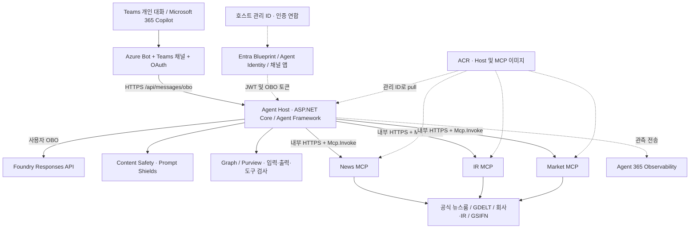

# LG Energy Solution AMA — Agent 365 한국어 실습 가이드

LG에너지솔루션의 회사 소개·뉴스·IR 자료·주가를 **공개 출처와 함께 답변하는 .NET 에이전트**입니다. Microsoft Agent Framework와 자체 MCP 서버를 사용하고 Azure Container Apps에서 실행합니다. Teams 개인 대화와 Microsoft 365 Copilot용 패키지를 제공합니다. 회사 공식 서비스 또는 투자 자문이 아닙니다.

이 가이드는 로컬 도구 검사부터 **본인의 Azure/Microsoft 365 환경**에 배포하는 순서까지 설명합니다.

> **검증 범위:** 공개 준비 시 .NET 테스트 167개가 통과했습니다. 원래 데모에서는 Web Chat 응답과 일부 Purview 입력 차단을 확인했지만 Teams의 `BotDisabledByAdmin`은 미해결이고 Teams/Copilot 전체 대화 검증은 완료되지 않았습니다. [검증 범위](docs/validation.md)를 확인하세요. 저장소 배포만으로 채널 사용이 자동 승인되는 것은 아닙니다.

## 실습 경로

| 경로 | 필요한 환경 | 완료 목표 |
|---|---|---|
| 로컬 MCP: 1–3단계 | Windows PC, .NET, PowerShell, Node.js, 인터넷 | MCP 3개 실행, 도구 5개 계약 검사와 공개 자료 조회 |
| 모델 연결: 4–5단계 | 기존 Foundry 모델, Azure 로그인과 호출 권한 | 모델이 로컬 MCP를 호출해 답변 |
| 전체 배포: 4단계, 6–11단계 | Azure 인프라, Agent 365/Entra, Teams/Copilot, Purview | OBO 인증, 컨테이너 배포, 패키지 업로드와 채널별 검증 |

로컬 MCP만 검사할 때는 Azure 계정·Agent 365 CLI·모델 API 키가 필요 없습니다. 전체 배포에는 관리자 협업과 정책 전파 시간이 필요합니다.

## 1. 사전 준비 — 도구·계정·권한

### 개발 도구

명령은 **프로젝트 루트의 PowerShell 7 (`pwsh`)**에서 실행합니다. 제공 스크립트는 Windows DPAPI, Windows 프로세스/포트 조회, System.Drawing을 사용하므로 **Windows 기준**입니다. macOS/Linux에서의 동일 절차는 검증하지 않았습니다. Azure 컨테이너는 Linux입니다.

| 도구 | 필요 여부 / 버전 | 용도 |
|---|---|---|
| Git | 필수 | 복제와 변경 관리 |
| .NET SDK | 필수: **10.0.403**, `global.json`의 `latestPatch` 범위 허용 | `net10.0` 빌드·MSTest·로컬 서버 |
| PowerShell | 필수: **7 이상** | `.ps1` 실행. Windows PowerShell 5.1과 구분 |
| Node.js | MCP 검사에 필요. 22 이상 권장; 이번 검증은 26.13.0 | 내장 `fetch`로 MCP 검사. 기본 검사에는 npm 설치 불필요 |
| Azure CLI (`az`) | 모델/클라우드 단계에 필요 | 로그인·Graph·ACR 빌드·ARM 배포·RBAC |
| Azure CLI Bicep | 클라우드 단계에 필요 | `az bicep install`; Bicep 컴파일과 what-if |
| `containerapp` 확장 | Container Apps 조회/관리용 | `az extension add --name containerapp --upgrade` |
| Agent 365 CLI (`a365`) | 전체 배포에 필요: **1.1.221** 기준 | Blueprint·Agent Identity·권한·메시지 엔드포인트 |
| ExchangeOnlineManagement | Purview 정책 단계에 필요 | Security & Compliance PowerShell 연결 |
| Microsoft.Graph.Authentication | Graph로 패키지를 게시할 때만 필요 | `Publish-TeamsPackage.ps1 -UseGraphPowerShell` |
| Docker Desktop | 선택 | 로컬 이미지 빌드. 이 가이드의 `az acr build`는 Azure에서 빌드하므로 불필요 |
| npm `sharp` | 아이콘 재생성 시에만 필요 | `npm install --no-save --package-lock=false sharp` 후 `node tools/Prepare-Icons.cjs` |

설치: [.NET](https://dotnet.microsoft.com/download/dotnet/10.0), [PowerShell](https://learn.microsoft.com/powershell/scripting/install/installing-powershell-on-windows), [Azure CLI](https://learn.microsoft.com/cli/azure/install-azure-cli-windows), [Agent 365 CLI](https://learn.microsoft.com/microsoft-agent-365/developer/agent-365-cli).

CLI와 C# SDK는 별개입니다. 주요 패키지는 Agent Framework 1.17.0, Agent 365 Runtime 1.0.0, MCP 2.1.0, Purview 1.17.0-rc1이며 `Directory.Packages.props`에서 고정합니다. Purview에는 사전 릴리스 의존성이 있습니다. CLI 2.x는 설정 흐름이 달라 1.1.221 명령과 혼용하지 마세요. [공식 변경 이력](https://github.com/microsoft/Agent365-devTools/blob/main/CHANGELOG.md)을 보고 별도로 마이그레이션을 검증해야 합니다.

### 계정·권한·라이선스

| 준비 사항 | 확인할 내용 |
|---|---|
| Azure 구독 | 리소스 생성, ACR 빌드, 역할 할당 권한. Contributor만으로 RBAC 할당이 가능한 것은 아님 |
| Microsoft 365 / Entra 테넌트 | Azure 로그인과 같은 테넌트, Agent 365/Entra Agent ID 이용 가능 여부 및 라이선스 |
| 신원/동의 관리자 | Blueprint/child identity/앱 생성, delegated permission 관리자 동의, 인증 연합 설정 |
| Teams/Copilot 관리자·사용자 | 사용자별 이용 자격, 맞춤 앱 업로드·허용·제공·설치 정책 |
| Foundry 호출자 | Responses API/도구 호출 가능한 모델 배포와 quota, child identity 및 실제 OBO 사용자의 데이터 접근 권한 |
| Content Safety | Prompt Shields 지원 엔드포인트와 호출 권한. 별도 계정이면 별도 RBAC 필요 |
| Purview 관리자 | 사용자 지정 AI 앱 검사 기능/라이선스, 활성화된 Application DLP 정책·규칙과 변경 권한 |

역할과 라이선스는 테넌트 관리자에게 확인하세요. 스크립트가 라이선스 구매/할당, 모든 관리자 역할 부여, 사용자 앱 설치까지 수행하지는 않습니다. Entra Owner/Sponsor 관계와 API 실행 권한도 별개입니다.

## 2. 아키텍처와 인프라 요구사항



호스트는 채널 JWT와 사용자를 확인하고 Blueprint와 child Agent Identity를 통해 리소스별 OBO 토큰을 교환합니다. 모델이 선택한 도구를 내부 MCP에서 실행하고 외부 콘텐츠 보호/정책 검사를 거쳐 출처와 함께 답변합니다. 모델·Content Safety·Graph·MCP는 서로 다른 토큰 대상이며 관측 전송에는 별도 app-only 경로를 사용합니다.

이 구현은 사용자 요청 중심 OBO 방식입니다. Agent User/AI Teammate, 전용 메일함, 자체 Direct Line 클라이언트를 구성하지 않습니다. 자체 MCP에 직접 연결하며 `EnableWorkIq=false`입니다. Agent 365 Tooling Gateway의 서버 등록/정책 실습과 구분하세요.

### 사전에 준비하는 리소스와 Bicep이 만드는 리소스

**빈 구독의 모든 기반을 만드는 템플릿이 아닙니다.** 기존 ACR·Container Apps 환경·AI 계정/모델을 먼저 준비해야 합니다. Azure 상용 클라우드 기준입니다.

| 리소스 | 수량 / 조건 | 생성 주체 |
|---|---|---|
| Resource Group | 실습용 1개, 기존 그룹 사용 가능 | 직접 준비 |
| Azure Container Registry | 1개, build/push/pull 가능 | **직접 준비**, foundation에서 참조 |
| Container Apps Environment | 1개, 내부 앱 통신/인터넷 egress 가능 | **직접 준비**, main에서 `existing` 참조 |
| Foundry 계정 + 모델 배포 | Responses API와 함수 호출 지원, quota 확보 | **직접 준비**, 모델 자동 생성 없음 |
| Content Safety / Prompt Shields | 지원 계정 엔드포인트 | **직접 준비**, 지원되는 동일 AI 계정 재사용 가능 |
| Log Analytics | 환경 로그 설정에 따라 준비 | 직접 구성. 이 Bicep은 생성하지 않음 |
| User-assigned Managed Identity | `id-agent-lgesama`, `id-mcp-lgesama` 2개 | `foundation.bicep` |
| ACR Pull 역할 | 위 두 ID에 각각 할당 | `foundation.bicep` |
| 공개 Agent Host | `ca-agent-lgesama`, 0.5 vCPU / 1 GiB | `main.bicep` → `container-app.bicep` |
| 내부 MCP 앱 | `ca-news-lgesama`, `ca-ir-lgesama`, `ca-market-lgesama`, 각 0.25 vCPU / 0.5 GiB | 동일 모듈, 같은 MCP 이미지의 프로필별 실행 |
| Azure Bot + Teams + OAuth | `bot-lgesama`, F0, 연결 `lges-ama-obo` | `bot.bicep`, `Deploy-Bot.ps1` |
| Blueprint / child Agent Identity | 프로젝트 전용 각 1개 | Agent 365 CLI |
| MCP API 앱 / OBO 채널 앱 / 서비스 주체 / 인증 연합 | 프로젝트 전용 | `Initialize-Tenant.ps1` |
| Purview 정책·규칙 | 활성화된 Application 정책 | 관리자 준비. 스크립트는 Blueprint 대상만 추가 |

ACR과 Container Apps Environment는 실습 Resource Group에 있어야 합니다. Foundry는 같은 구독의 별도 그룹에 둘 수 있습니다. 환경과 앱의 지역을 맞추세요. ACR은 템플릿의 `AcrPull`과 호환되는 권한 모드가 필요하며 ABAC 기반 저장소 권한 환경은 조정이 필요합니다.

네 컨테이너의 최소/최대 replica는 모두 1이며 총 **1.25 vCPU / 2.5 GiB**를 할당합니다. MCP를 항상 실행하여 시작 지연을 줄입니다. 호스트의 메모리 세션 때문에 replica를 늘리면 대화 상태가 분리됩니다. DB, Redis, Azure AI Search, Storage Account, AKS, Key Vault는 이 구현의 필수 리소스가 아니며 템플릿에도 없습니다. Application Insights 연결 문자열 매개변수는 있지만 호스트 exporter는 Agent 365이므로 문자열만 넣어 Insights 수집이 구성되지는 않습니다.

네트워크는 호스트 HTTPS ingress, 환경 내 MCP HTTPS, Entra/Graph/Foundry/Content Safety/관측 서비스 HTTPS와 ACR 이미지 pull을 허용해야 합니다. 공개 자료의 허용 호스트는 `www.lgensol.com`, `inside.lgensol.com`, `api.gdeltproject.org`, `ir.gsifn.io`입니다. 빌드에는 NuGet/Microsoft 컨테이너 레지스트리 접근도 필요합니다. VNet·Private Endpoint·방화벽 정책은 템플릿에서 구성하지 않습니다.

### 에이전트가 호출하는 도구

| MCP / 로컬 포트 | 도구 | 입력 / 결과 |
|---|---|---|
| news / 5211 | `search_company_news` | `query`, `days` 1–90, `limit` 1–15 → 뉴스 출처·링크 |
| news / 5211 | `read_news_article` | 검색의 `articleId` → 공식 기사 본문 |
| ir / 5212 | `get_company_overview` | `language`: `ko`/`en` → 회사 개요 |
| ir / 5212 | `get_ir_materials` | `year` (0은 전체), `limit` 1–25 → IR 문서 링크 |
| market / 5213 | `get_stock_quote` | 입력 없음 → KOSPI 373220, KRW, 기준 시각·출처 |

IR PDF 본문 추출과 실시간 거래소 시세는 구현하지 않습니다. 주가가 4일을 넘으면 오래된 자료로 표시하고 파싱 실패 시 값을 생성하지 않습니다. GDELT 실패 시 공식 자료의 부분 결과를 안내합니다. [자료 출처와 제한](docs/sources.md)을 참고하세요.

## 3. 복제·빌드·로컬 MCP 실습

```powershell
git clone https://github.com/patrick-shim/public-demo.git
Set-Location public-demo
dotnet --version
$PSVersionTable.PSVersion
node --version
dotnet restore Lges.Ama.slnx
dotnet build Lges.Ama.slnx -c Release --no-restore
dotnet test Lges.Ama.slnx -c Release --no-build
pwsh -File tests/TeamsPackage.Validation.Tests.ps1
pwsh -File tests/Set-LgesPurviewDlpPolicy.Tests.ps1
pwsh -File tools/Test-PublishTeamsPackage.ps1
pwsh -File tests/LabSettings.Tests.ps1
```

`NuGet.Config`는 공개 nuget.org를 사용합니다. 사내 승인 미러가 필요하면 source를 변경하고 사용자 인증 정보는 커밋하지 마세요. **이번 작업 환경은 nuget.org 직접 TLS 연결이 실패하여 새 PC에서의 전체 공개 피드 복원을 검증하지 못했습니다.** 테스트는 기존 패키지 캐시로 검증했습니다. 복원 실패 시 네트워크와 고정 버전의 제공 여부를 먼저 확인하세요.

```powershell
./tools/Start-LocalMcp.ps1
try {
    Invoke-RestMethod http://127.0.0.1:5211/health
    Invoke-RestMethod http://127.0.0.1:5212/health
    Invoke-RestMethod http://127.0.0.1:5213/health
    node tools/Inspect-Mcp.mjs
    dotnet run --project tools/Lges.Ama.Smoke -c Release
    node tools/Inspect-Mcp.mjs --live
} finally {
    ./tools/Stop-LocalMcp.ps1
    Remove-Item Env:ASPNETCORE_ENVIRONMENT -ErrorAction SilentlyContinue
}
```

완료 기준은 smoke의 **도구 5개 이름·설명·스키마 PASS**와 live 도구 결과입니다. live는 인터넷 공급자 상태에 영향을 받고 `.local/validation/mcp-live.json`에 결과를 저장합니다. `--write-contracts`는 계약을 변경하므로 일반 검사에 쓰지 않습니다. 로컬 서버는 loopback/Development 모드이며 운영 JWT/OBO/Purview 검증을 대신하지 않습니다. 호스트의 Development 설정은 정책과 MCP가 꺼져 있으므로 운영 데모에 사용하지 마세요.

## 4. 내 환경 설정과 Azure 로그인

2단계의 기존 리소스를 준비한 뒤 아래 파일을 작성합니다. 이미 온보딩한 폴더라면 기존 설정을 덮어쓰지 마세요.

```powershell
New-Item -ItemType Directory -Path .local/onboarding,.local/validation -Force | Out-Null
Copy-Item lab.settings.example.json .local/lab.settings.json
# 편집기로 .local/lab.settings.json의 <...>를 자신의 값으로 모두 교체
```

| 설정 | 의미 |
|---|---|
| `TenantId`, `SubscriptionId` | 본인의 테넌트/구독 GUID |
| `ResourceGroup`, `Location` | 기존 ACR/Container Apps 환경의 그룹과 지역 |
| `RegistryName`, `EnvironmentName` | 리소스 이름. ACR 이름에 `.azurecr.io`를 붙이지 않음 |
| `FoundryResourceGroup`, `FoundryAccountName` | 역할을 할당할 AI 계정의 그룹과 이름 |
| `FoundryEndpoint` | `https://<account>.services.ai.azure.com` 계정 URL |
| `FoundryModel` | Responses API를 지원하는 실제 모델 **배포 이름** |
| `PromptShieldEndpoint` | `https://<account>.cognitiveservices.azure.com` 지원 계정 URL |

코드 속성명이 `FoundryProjectEndpoint`여도 `/api/projects/...`를 넣지 않습니다. 코드가 계정 URL 뒤에 `/openai/v1`을 붙입니다. 원래 모델은 `gpt-5.6-sol`이었지만 다른 구독에 같은 배포가 있다고 가정하지 않습니다. 사용 가능한 모델로 바꾼 후 함수 호출과 답변을 검증하세요.

```powershell
. ./tools/Tenant.Common.ps1
Import-LabSettings
az login --tenant $TenantId
az account set --subscription $SubscriptionId
Assert-DemoTenant
az account show --query '{tenant:tenantId,subscription:id}' -o json
az bicep install
az extension add --name containerapp --upgrade
az acr show -n $RegistryName -g $ResourceGroup --subscription $SubscriptionId -o table
az containerapp env show -n $EnvironmentName -g $ResourceGroup --subscription $SubscriptionId -o table
az cognitiveservices account deployment list -n $FoundryAccountName -g $FoundryResourceGroup --subscription $SubscriptionId -o table
```

새 PowerShell 창에서는 공통 스크립트를 다시 dot-source하고 `Import-LabSettings`로 변수를 불러옵니다. 변경 스크립트는 설정과 현재 Azure 테넌트/구독의 일치를 검사합니다.

## 5. 선택 실습 — 모델과 로컬 도구 연결

로그인한 개발자의 Foundry 데이터 접근 권한이 필요하며 모델 요금이 발생합니다.

```powershell
$env:AZURE_TENANT_ID = $TenantId
$env:AgentHost__FoundryProjectEndpoint = $FoundryEndpoint
$env:AgentHost__FoundryModelDeployment = $FoundryModel
./tools/Start-LocalMcp.ps1
try {
    dotnet run --project tools/Lges.Ama.Smoke -c Release -- --model
} finally {
    ./tools/Stop-LocalMcp.ps1
    Remove-Item Env:ASPNETCORE_ENVIRONMENT -ErrorAction SilentlyContinue
}
```

기대 결과는 도구로 조회한 주가·통화·기준 시각·출처를 포함한 답변입니다. 이 smoke는 개발자 Azure CLI 자격 증명을 사용하며 Teams 사용자 OBO, Purview, 운영 Agent Identity 권한, 포털 관측 수집은 검증하지 않습니다.

## 6. Agent 365 신원과 관리 ID 생성

기존 전역 CLI를 변경하지 않는 실습 전용 설치 예입니다. `dotnet --list-runtimes`로 CLI용 .NET/ASP.NET Core 런타임도 확인하세요.

```powershell
dotnet tool install Microsoft.Agents.A365.DevTools.Cli --version 1.1.221 --tool-path .local/a365-cli
$env:PATH = "$(Join-Path (Get-Location) '.local/a365-cli');$env:PATH"
a365 --version
a365 setup all --help
Push-Location .local/onboarding
try {
    a365 setup all --agent-name 'LG Energy Solution AMA' --tenant-id $TenantId --authmode obo --m365
} finally { Pop-Location }
```

관리자 로그인/동의를 완료합니다. 새 프로젝트 최초 실행에만 신원을 생성하고 재실행 전 기존 ID를 확인하세요. 아직 호스팅하지 않았다면 메시지 엔드포인트는 이후 등록합니다. `--aiteammate`를 사용하지 않습니다. 생성 파일은 `.local/onboarding/a365.config.json`, `a365.generated.config.json`이며 child identity인 `agenticAppId`가 필요합니다.

```powershell
az deployment group what-if --subscription $SubscriptionId -g $ResourceGroup -n lgesama-foundation --template-file infra/foundation.bicep --parameters registryName=$RegistryName location=$Location
az deployment group create --subscription $SubscriptionId -g $ResourceGroup -n lgesama-foundation --template-file infra/foundation.bicep --parameters registryName=$RegistryName location=$Location --mode Incremental --query properties.outputs -o json > .local/foundation.json
if ($LASTEXITCODE -ne 0) { throw 'Foundation 배포 실패' }
./tools/Initialize-Tenant.ps1
```

Foundation은 관리 ID 2개와 AcrPull을 만듭니다. 초기화는 MCP API의 `Mcp.Invoke`, 채널 SSO scope, Blueprint의 `access_agent_as_user`, 호스트 관리 ID의 인증 연합을 연결합니다. Bot OAuth 비밀은 6개월 만료이며 `.local/channel-secret.dpapi`에 Windows 사용자/컴퓨터에 묶인 암호문으로 보관합니다. 다른 PC로 파일만 복사해도 복호화되지는 않습니다.

완료 기준: `foundation.json`에 관리 ID 출력, `.local/deployment.json`에 `blueprintId`, `agentIdentityId`, `channelAppId`, `mcpAppId`, `teamsAppId`. 다른 프로젝트의 ID/비밀을 복사하지 마세요. 앱과 리소스 이름은 기본 고정이므로 동일 테넌트/그룹에서 두 번째 실습을 만들 때 이름 충돌부터 해결해야 합니다.

## 7. 실행 권한과 Purview 정책

```powershell
Push-Location .local/onboarding
try {
    a365 setup permissions custom --dry-run
    a365 setup permissions custom
} finally { Pop-Location }
./tools/Set-RuntimePermissions.ps1
```

MCP·Foundry·Content Safety·Purview 선언에 동의한 뒤 권한을 조정합니다. 마지막 스크립트는 **이 Blueprint의** Graph 동의를 `Content.Process.User`, `ProtectionScopes.Compute.User`, `ContentActivity.Write`로 맞추고 미사용 Work IQ/Power Platform 동의를 제거합니다. child identity에는 Foundry 계정 범위 **Cognitive Services User**를 할당합니다. 전체 setup을 다시 실행하면 넓은 기본 권한이 재도입될 수 있어 이 단계도 다시 검토합니다.

실제 OBO 사용자/그룹의 모델 접근은 관리자가 별도 부여합니다. Content Safety가 다른 계정이면 그 계정의 child identity/사용자 권한도 준비하세요. 스크립트가 모든 사용자를 승인하거나 호스트 관리 ID에 모델 권한을 우회 부여하지 않습니다.

Purview는 **Application plane에서 활성화된 기존 정책과 규칙**이 필요합니다. 다음은 규칙 생성 없이 Blueprint를 대상에 추가합니다.

```powershell
Install-Module ExchangeOnlineManagement -Scope CurrentUser
$state = Get-Content .local/deployment.json -Raw | ConvertFrom-Json
$policyArgs = @{
    PolicyName = '<준비한-DLP-정책-이름>'
    BlueprintAppId = $state.blueprintId
    TenantId = $TenantId
    UserPrincipalName = '<Purview-관리자-UPN>'
}
./Set-LgesPurviewDlpPolicy.ps1 @policyArgs          # 조회와 계획
./Set-LgesPurviewDlpPolicy.ps1 @policyArgs -Apply   # 대상 추가
```

기존 연결은 연결을 만든 같은 세션에서 `-UseExistingSession`으로 재사용하며 `-WhatIf`도 지원합니다. 기존 대상·규칙·모드를 보존하고 전후 자료를 `.local/purview`에 저장합니다. 서버의 `PurviewDlp__ApplicationId`는 **Blueprint ID**와 같아야 합니다. 입력(UploadText)과 출력(DownloadText) 차단, 정책 저장과 실제 적용은 각각 구분해 검증하세요.

## 8. 이미지 빌드와 Container Apps 배포

```powershell
$ReleaseTag = Get-Date -Format 'yyyyMMdd-HHmmss'
az acr build --subscription $SubscriptionId -r $RegistryName -t "lges-ama/host:$ReleaseTag" -f Dockerfile .
if ($LASTEXITCODE -ne 0) { throw 'Host 빌드 실패' }
az acr build --subscription $SubscriptionId -r $RegistryName -t "lges-ama/mcp:$ReleaseTag" -f Dockerfile.mcp .
if ($LASTEXITCODE -ne 0) { throw 'MCP 빌드 실패' }
./tools/New-DeploymentParameters.ps1 -ReleaseTag $ReleaseTag
az deployment group what-if --subscription $SubscriptionId -g $ResourceGroup -n lgesama-apps --template-file infra/main.bicep --parameters '@.local/main.parameters.json'
az deployment group create --subscription $SubscriptionId -g $ResourceGroup -n lgesama-apps --template-file infra/main.bicep --parameters '@.local/main.parameters.json' --mode Incremental --query properties.outputs -o json > .local/app-outputs.json
if ($LASTEXITCODE -ne 0) { throw '앱 배포 실패' }
```

매개변수 생성기는 태그에서 찾은 이미지를 **sha256 digest에 고정**합니다. 두 Dockerfile은 .NET 10 SDK로 빌드하고 ASP.NET 10 Linux 런타임으로 실행합니다. 컨테이너 포트는 8080이며 외부 URL은 HTTPS입니다. Host만 public ingress, MCP는 내부 ingress와 Entra scope를 사용합니다.

순서는 `foundation.bicep`(ID/pull) → `main.bicep`(앱/환경 변수, 공통 `container-app.bicep` 사용) → 다음 단계의 `bot.bicep`(Bot/Teams/OAuth)입니다. what-if에서 공유 리소스 변경을 검토하고 증분 배포합니다.

```powershell
$outputs = Get-Content .local/app-outputs.json -Raw | ConvertFrom-Json
$baseUrl = "https://$($outputs.hostFqdn.value)"
Invoke-RestMethod "$baseUrl/api/health/live"
Invoke-RestMethod "$baseUrl/api/health/ready"
az containerapp list -g $ResourceGroup --subscription $SubscriptionId -o table
```

완료 기준은 네 앱의 정상 revision과 live 성공입니다. ready는 HTTP 200과 메모리 저장소 `degraded` 경고를 반환할 수 있습니다. 다중 replica 운영 준비 완료를 뜻하지 않습니다. 내부 MCP 주소를 PC에서 직접 열 수 없는 것은 의도된 구성입니다.

## 9. Bot 연결과 메시지 엔드포인트

```powershell
./tools/Deploy-Bot.ps1 -WhatIf
./tools/Deploy-Bot.ps1
$outputs = Get-Content .local/app-outputs.json -Raw | ConvertFrom-Json
Push-Location .local/onboarding
try {
    a365 setup blueprint --endpoint-only --messaging-endpoint $outputs.messagingEndpoint.value
} finally { Pop-Location }
```

메시지 URL은 `https://<host>/api/messages/obo`입니다. `/api/messages/agentic`을 사용하지 않습니다. Bot 앱 ID는 **channelAppId**, Purview 적용 ID는 **blueprintId**, 실행 신원은 **agentIdentityId**입니다.

Bot 배포 스크립트는 OAuth 비밀의 임시 평문 매개변수를 `.local`에 만들고 `finally`에서 제거합니다. 강제 종료됐다면 잔존 파일을 확인해 삭제하세요. 임시 비밀 파일과 DPAPI 암호문은 Git/Docker 공개 대상에서 제외합니다.

## 10. Teams/Copilot 패키지와 업로드

```powershell
./tools/New-TeamsPackage.ps1    # 현재 manifest 버전의 ZIP
# 기존 앱 업데이트 시에만 실행: patch 버전을 올리고 새 ZIP 생성
# ./Update-TeamsPackage.ps1
```

결과는 `artifacts/packages/LGES-AMA-Teams-Copilot-<버전>.zip`과 최신 별칭 `LGES-AMA-Teams-Copilot.zip`입니다. ZIP 루트에 manifest와 192×192 color/32×32 흰색·투명 outline 아이콘을 넣고 검사합니다. ID는 `.local`의 현재 배포 값으로 채웁니다.

1. 관리자가 Microsoft 365/Teams 관리 센터의 테넌트 업로드 경로에서 등록합니다.
2. 기존 앱 업데이트는 ID를 유지하고 더 높은 버전으로 업로드합니다.
3. 테스트 사용자의 제공 범위·허용 정책·설치를 확인합니다.
4. Teams 개인 대화와 Copilot에서 각각 로그인하고 질문합니다.

Graph 게시가 필요할 때만 아래 경로를 사용합니다. `AppCatalog.ReadWrite.All` 동의가 필요하고 사용자 설치는 별도입니다.

```powershell
Install-Module Microsoft.Graph.Authentication -Scope CurrentUser
./tools/Publish-TeamsPackage.ps1 -UseGraphPowerShell
```

기존 카탈로그 ID를 찾아 업데이트하며 같거나 낮은 버전은 거부합니다. **이 OBO 프로젝트의 ZIP 생성을 `a365 publish`로 대체하는 것은 검증하지 않았습니다.** CLI 일반 게시 절차와 혼용하지 마세요.

## 11. 완료 점검과 문제 해결

| 점검 | 기대 결과 |
|---|---|
| 회사 소개 / 뉴스 | 공식 출처, 기사 날짜, 회사 발표/외부 보도 구분 |
| 기사 본문 / IR | articleId 본문 조회, IR PDF 링크 제공, 없는 숫자 생성 안 함 |
| 주가 | KOSPI 373220, KRW, 기준 시각과 지연/오래된 자료 안내 |
| Teams / Copilot | 각 채널에서 실제 사용자 OBO 로그인과 답변을 별도 확인 |
| Purview | 일반 질문 허용, 승인된 합성 입력 차단; 출력 차단은 해당 규칙이 있을 때 별도 확인 |
| Prompt Shields / 관측 | 승인된 테스트의 정책 결과와 Agent 365 포털 수집 확인 |

| 증상 | 확인할 곳 |
|---|---|
| SDK/restore 실패 | `global.json`, SDK 버전, NuGet 네트워크·고정 버전·feed |
| 5211–5213 사용 중 | 기존 MCP를 Stop 스크립트로 종료. 다른 프로그램을 임의 종료하지 않음 |
| 테넌트 검사 실패 | 설정과 `az account show`의 일치 |
| 이미지 pull 실패 | ACR/digest, 두 ID의 AcrPull, ACR 권한 모드·네트워크 |
| 모델 401/403 | 계정 URL, 배포 이름, resource별 OBO 토큰, child identity와 사용자 RBAC |
| MCP 401/403 | Mcp.Invoke 관리자 동의, API audience, 실제 토큰·내부 ingress |
| Teams `BotDisabledByAdmin` | 앱 허용·제공·설치·정책 전파·호스트 수신 로그. 전체 setup을 무조건 재실행하지 않음 |
| Purview 미차단/오류 | Blueprint ID, Graph scope, 정책 방향·탐지 신뢰도·전파. 모델 답변만으로 정상 검사라고 판단하지 않음 |
| 첫 요청 timeout | 최소 replica=1, readiness, 외부 공급자 지연 |
| 데이터 없음 | 공급자 오류·HTML 구조 변경·부분 결과 여부 |
| ZIP 업로드 실패 | 새 ZIP 재선택, 아이콘 검사, 버전·ID·관리자 정책 |

Health, 카탈로그 게시, 설치, 실제 대화, 정책 적용은 각각 별도 완료 항목입니다. 질문 예시는 [시연 가이드](docs/demo-script.ko.md)를 참고하세요.

## 12. 비용·운영·정리

공개 데이터는 키 없이 사용하지만 Container Apps replica, ACR 빌드/저장소, 모델, Content Safety, 로그, Microsoft 365/Agent 365/Purview 비용은 별도입니다. Bot F0가 전체 무료를 뜻하지 않습니다. 지역·모델·라이선스·사용량에 맞춰 산정하세요.

전용 앱의 최소 replica를 0으로 낮추면 유휴 비용을 줄일 수 있지만 요청 시 재기동하므로 완전한 비용 중지는 아닙니다. 다음 시연 전 네 앱을 1로 복원하고 도구를 확인하세요. 공유 ACR·환경·Foundry·그룹을 통째로 삭제하지 마세요. 완전 정리는 이번 실습의 앱·Bot·ID·역할·Entra 등록·카탈로그·정책 대상·이미지를 식별해 진행합니다. 자동 정리 스크립트는 제공하지 않습니다.

운영 전에는 영속 대화 저장소, 부하/확장 검증, OAuth 비밀 갱신, 이미지 보안 업데이트, 정책·관측 검증, 비용 경보가 필요합니다. 모델 요청/응답 비저장 설정이 조직의 Purview 감사나 모든 서비스의 보존 정책을 없애는 것은 아닙니다.

## 저장소 구조와 공개 범위

| 경로 | 내용 |
|---|---|
| `server/agent` | 회사 전용 지침과 Agent Framework |
| `server/agent-host` | ASP.NET Core, OBO, MCP 연결, 정책, 세션/관측 |
| `server/mcp` | news/ir/market와 공통 인증/실행 코드 |
| `server/integrations` | 공개 HTTP, 파싱, 캐시 |
| `contracts` | 고정 도구 이름·설명·스키마 해시 |
| `infra` | ID, 앱, Bot Bicep |
| `tools`, `tests` | 실습·배포·패키징·검증 |
| `channel/appPackage` | manifest 템플릿과 아이콘 |
| `lab.settings.example.json` | 환경 설정 템플릿 |
| `.local` | 개인 환경/신원/비밀/검증 결과. 커밋 금지 |

공개본에는 원래 테넌트 설정, 진단 ZIP, 내부 포털 스크린샷, 로컬 발표 제작 스크립트, 생성된 배포·패키지 파일을 포함하지 않습니다. MIT는 회사 로고·상표 사용권을 부여하지 않습니다. [브랜드 출처](assets/brand/README.md), [LICENSE](LICENSE)를 확인하세요.

관련 문서: [배포 파일 안내](docs/deployment.ko.md), [검증 범위](docs/validation.md), [Owner/Sponsor와 게시자](docs/portal-roles.ko.md), [자료 출처](docs/sources.md).
